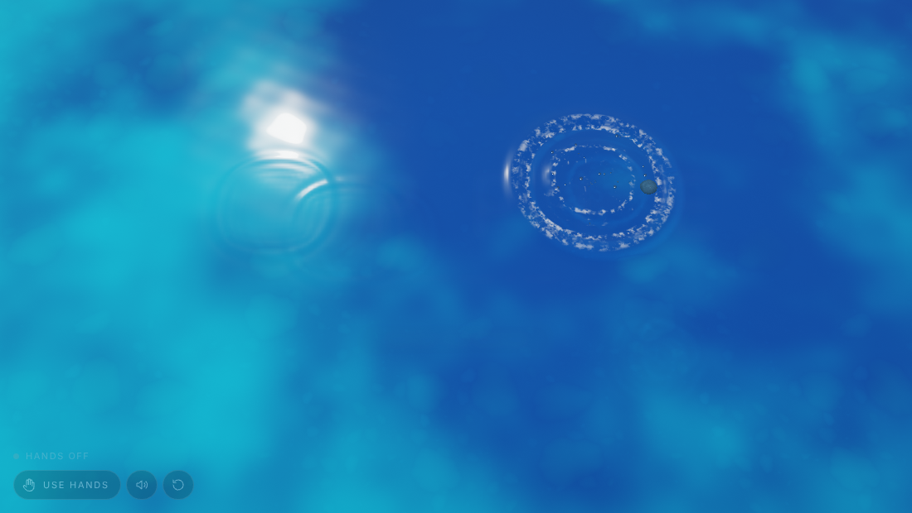

# RIPPLE

*Touch a world made of water.*

RIPPLE turns the browser viewport into a still, dark pond. Dip your fingers in front of the webcam,
pinch and drop a pebble, drag your hand through the surface or sweep a wave across it, and watch
the ripples spread, overlap, catch the moonlight and settle back into silence. Mouse and touch drive
exactly the same water when no camera is used.



The water is a real-time GPU height-field simulation, not animated circles over a picture. It is a
convincing approximation, not a physically exact fluid model.

---

## Quick start

```bash
npm install          # also copies the MediaPipe WASM runtime into public/mediapipe/wasm
npm run fetch-model  # downloads public/models/hand_landmarker.task (skipped if present)
npm run dev          # http://localhost:5173
```

Open the page in desktop Chrome, choose **ENTER THE WATER**, and touch the water with the mouse.
Choose **Use hands** to enable the webcam. Camera access works on `http://localhost` and `https://`
origins.

| Script | What it does |
| --- | --- |
| `npm run dev` | Vite dev server |
| `npm run build` | Type-check (`tsc --noEmit`) and production build into `dist/` |
| `npm run preview` | Serve the production build locally |
| `npm test` | Run the Vitest suite |
| `npm run typecheck` | Type-check only |
| `npm run fetch-model` | Download the hand landmarker model (`--force` to re-download) |

### Deploying (GitHub Pages)

Pushes to `main` run `.github/workflows/deploy.yml`, which tests, builds with the repository's
base path (`BASE_PATH`, e.g. `/Ripple`) and publishes `dist/`. In the repository's
**Settings → Pages**, set **Source** to **GitHub Actions**. Serving the repository files directly
("Deploy from a branch") shows a blank page, because browsers cannot run the unbuilt TypeScript
source. For any other static host, run `npm run build` (with `BASE_PATH=/sub/path` if it is not
served from the domain root) and upload `dist/`.

Requirements: Node 18+ and a browser with WebGL 2. The simulation prefers float render targets
(`EXT_color_buffer_float`) and falls back automatically (see *Reliability*).

---

## How to play

### Mouse and touch

| Action | Effect |
| --- | --- |
| Click / tap | A fingertip dips in: a ripple rings outwards |
| Click and drag | A continuous wake that follows the pointer; faster drags make larger waves |
| Quick flick | A broad, directional wave |
| Press and hold (~0.4 s), then release | Pick up a pebble, carry it, and let it drop. Release while moving to throw it harder |
| Two fingers pinching together / apart (touch) | Squeeze the water inwards / let it spring outwards |

### Hands (webcam)

| Gesture | Effect |
| --- | --- |
| **Dip your fingers.** Extend your fingers | Each extended fingertip is its own ripple source. Spread them for separate rings and bring them together for interference. Curl a finger (or make a fist) to lift it out |
| **Drop a pebble.** Pinch thumb and index, move, then open | A pebble appears in your pinch and follows it. Opening drops it with a splash. A fast release throws it harder |
| **Drag through water.** Move an open hand | Wakes trail every fingertip; fast movement adds a broad palm wake |
| **Push a wave.** Quick sideways swipe with an open palm | One broad wave travels away from your hand (with a cooldown) |
| **Two-hand compression.** Bring both open hands together, then apart | Waves converge between your hands, then spread outwards |
| **Hold still.** Keep an open hand steady | No new energy enters the water; watch it settle |

A webcam sees only two dimensions, so it can't measure how far your finger is from the screen.
RIPPLE therefore treats an **extended finger as touching the water** and a curled finger as lifted out.
Soft glows on the surface show where tracked fingertips are.

The camera preview in the corner is mirrored, and so is the mapping: move your hand right and the
water is disturbed on the right. Use the **calibrate** button (target icon) and sweep one hand to
the edges of a comfortable reach. That region of the camera frame then maps to the whole screen.
The calibration is remembered in `localStorage`.

### Keyboard

`Space` drop a pebble · `R` still the water · `M` mute · `C` camera on/off.

### URL options

| Parameter | Meaning |
| --- | --- |
| `?debug` | Show FPS, simulation backend, grid size, quality level and tracker timing |
| `?quality=0…3` | Pin a quality level (0 = best) and disable adaptation |
| `?sim=cpu` | Force the CPU simulation fallback |
| `?boundary=reflect` | Waves reflect off the edges instead of being absorbed |
| `?mood=night` | The original dark, moonlit pond instead of the bright daytime water |

---

## Architecture

```
Webcam ─► CameraManager ─► HandTracker (Web Worker, MediaPipe) ─► GestureClassifier ─┐
Mouse / touch ─► PointerController ─────────────────────────────────────────────────┤
                                                                                     ▼
                                    InteractionController (InteractionSink: one API for every input)
                                       │  contacts, wakes, pebbles, pushes, compression
                                       ▼
                                 DisturbanceQueue (preallocated, batched)
                                       ▼
                                 WaterSimulation (GPU ping-pong height field / CPU fallback)
                                       ▼
                                 WaterRenderer (surface, floor, pebbles, splash particles)
                                       ▼
                                 AudioController (feedback hooks)
```

The renderer and simulation never see MediaPipe objects. Every input source speaks the same
`InteractionSink` interface in normalised screen coordinates. The pointer and the camera produce
the same disturbances, the same splashes and the same sounds.

```
src/
  app/          App.tsx, RippleEngine.ts (owns everything), Loop.ts, interactionState.ts
  camera/       CameraManager, HandTracker (+ handWorker), GestureClassifier, landmarkFeatures,
                CoordinateMapper (mirroring + calibration), OneEuroFilter
  interaction/  InteractionController, PointerController, PebbleSystem, DisturbanceQueue, detectors, types
  water/        WaterSimulation (GPU + CPU backends), CpuWaveSolver, disturbance, simulationParams,
                WaterRenderer, WaterMaterial, FloorGenerator, SplashParticles, shaders/*.glsl
  audio/        AudioController (procedural Web Audio)
  performance/  PerformanceMonitor (adaptive quality)
  ui/           LandingScreen, WaterHUD, CameraStatus, CameraPreview, Hint, ErrorState
  styles/       global.css
  tests/        Vitest suites
```

### Water simulation

`water/shaders/waveStep.frag.glsl` advances a damped 2D wave equation on a height field:

```
next = 2c − p + c²∇²c − damping·(c − p) + viscosity·∇²(c − p)
```

- State lives in RGBA float render targets (R = current height, G = previous height). Two targets
  ping-pong, so no pass ever reads the texture it writes.
- The Courant number `c² = 0.3` stays below the 2D stability limit of 0.5. Steps are fixed and
  scaled with resolution, so waves cross the screen at the same speed at every quality level. Any
  backlog beyond 8 steps per frame is dropped rather than spiralling.
- Damping is defined per second. A viscosity term makes small ripples die faster than broad waves.
  A weak restoring term removes any mean offset, so the pond always returns to true stillness.
  Heights are clamped and NaN-guarded.
- Boundaries: Neumann (reflective) edges with an optional absorbing sponge layer (the default).
- Disturbances are batched, 32 per pass, as uniform arrays: no textures or materials are created
  per interaction. Their shapes are:
  - **Drop**: a Gaussian displacement (fingertip dip, droplet landing).
  - **Wake**: a moving dipole with a bow and a trough (fingertip drag).
  - **Push**: an elongated profile seeded into both the current and previous fields with a
    one-step shift, so it genuinely travels in its direction.
  - **Impact**: a crater with a downward velocity and a raised rim (pebble).
- `CpuWaveSolver` is the same algorithm in TypeScript. It is the fallback backend and the reference
  implementation the tests exercise. The GLSL in `disturbance.frag.glsl` mirrors
  `evaluateDisturbance()` line for line.
- When the window is resized or the quality changes, the state is resampled into the new grid, so
  the waves carry on.

### Rendering

A perspective camera looks down into the pond at a 27° tilt over a subdivided plane that covers
the view. Vertices are displaced by the height field. Per-pixel normals come from neighbouring
height samples, and a barely visible breeze stops the untouched surface from being a perfect
mirror.

- **Refraction.** View rays are refracted (IOR 1.333) and intersected with a pond floor of varying
  depth, with relief taken from the floor texture. As the surface moves, the stones beneath wobble
  and shift.
- **Pond floor.** A procedural, seamlessly tileable bed of silt, gravel, pebbles and rocks is baked
  once into a mipmapped texture (`floor.frag.glsl`), with relief, soft occlusion and colour
  variation.
- **Absorption and depth.** Beer–Lambert attenuation along the refracted path plus in-scattering
  give the dark charcoal and midnight-blue depth.
- **Reflection and Fresnel.** A Schlick Fresnel term blends refraction with a procedural night
  sky: horizon glow, veiled clouds, overhanging foliage silhouettes and a moon. Ripples break the
  moon's reflection into glitter.
- **Caustics.** A slow, restrained procedural web, plus light focused by the simulated surface
  (from the curvature of the height field), so ripples throw moving bright and dark bands onto the
  stones.
- **Splashes.** Pooled particles. Droplets arc out of pebble impacts and re-disturb the water where
  they land. Bubbles rise from a sinking pebble.
- **Output.** ACES tone mapping, a gentle vignette and dithering against banding. No bloom and no
  chromatic aberration.

### Hand tracking

- **Local only.** The camera starts only when the user asks for it. Frames never leave the
  browser: they're copied into `ImageBitmap`s and transferred to a Web Worker running the MediaPipe
  Hand Landmarker (GPU delegate, CPU fallback). Inference therefore never blocks the render loop.
  Only one frame is in flight at a time. If workers or `createImageBitmap` are unavailable, the
  same model runs on the main thread, and its detection rate adapts to inference time.
- **Up to two hands.** The tracker returns 21 landmarks per hand. The classifier then computes:
  - fingertips (all five) and the palm centre;
  - hand openness and per-finger extension;
  - the pinch ratio (thumb–index distance divided by hand size), with hysteresis and debounce;
  - palm and pinch velocities.
- **Smoothing.** A One Euro filter keeps fingertips steady at rest and responsive in fast moves.
  Smoothed contacts are then followed for a few milliseconds in the interaction engine. The water
  therefore moves smoothly at 60 fps even though tracking updates arrive at 20–30 Hz.
- **Robustness:**
  - Confidence and validity checks discard bad landmarks.
  - Hand identity stays stable across frames (handedness first, nearest palm second).
  - A large jump is treated as re-acquisition, so no wake is drawn across the screen.
  - Brief tracking loss is bridged; the grace period lengthens on slow devices.
  - After a long loss the hand lets go: contacts end and a held pebble is dropped, never left
    floating. Existing waves always continue.
- **Turning the camera off** stops every media track. Unplugging the camera, denying permission or
  a missing model each produce a clear message in the status line, and pointer input keeps working.

### Sound

Everything is synthesised with the Web Audio API; there are no audio files. The sounds are:

- a quiet, breathing water ambience with rare distant drips;
- a rising-pitch *plink* for gentle pebbles;
- a deeper splash with a scatter of droplets for throws;
- one continuous swish whose level follows drag speed (never a sound per frame);
- a low swell for broad waves.

Every sound has an envelope. Voices are capped and the mix runs through a compressor. Audio starts
only after **ENTER THE WATER** (autoplay policy) and can be muted (`M`).

### Performance

Quality levels (`performance/PerformanceMonitor.ts`) set the simulation resolution (512 → 224 on
the long side), the device-pixel-ratio cap (1.75 → 0.75), the mesh density and the particles. The
monitor measures frame time and steps down after sustained slow frames. It steps back up cautiously,
at most twice, with settle periods to avoid oscillation. The render loop:

- allocates nothing per frame;
- reuses every material, geometry and render target;
- batches disturbances.

---

## Reliability and fallbacks

| Situation | Behaviour |
| --- | --- |
| No WebGL 2 | Full-screen explanation instead of a blank page |
| Float render targets unsupported, or failing a read-back self-test | Half-float targets, then the CPU simulation at reduced resolution |
| Simulation shader fails to compile | CPU simulation |
| Water shader fails to compile | Clear error with the compiler log |
| GPU context lost | Loop stops; message with a reload button |
| Camera permission denied / no camera / camera busy / unplugged | Status-line message; pointer input continues |
| Hand model missing | Message explaining `npm run fetch-model` (detected even when the dev server answers with `index.html`) |
| MediaPipe WASM fails to load | Message naming the path |
| React StrictMode / remounts | The engine is disposed fully (GPU resources, WebGL context, camera, worker, audio, listeners). The loop guards against duplicates |

---

## MediaPipe model and licences

- **Model.** `public/models/hand_landmarker.task` is MediaPipe Hand Landmarker (float16, v1):
  `https://storage.googleapis.com/mediapipe-models/hand_landmarker/hand_landmarker/float16/1/hand_landmarker.task`.
  It is published by Google under the **Apache License 2.0**; see the
  [MediaPipe hand landmarker documentation](https://ai.google.dev/edge/mediapipe/solutions/vision/hand_landmarker)
  and its model card.
- **Runtime.** `@mediapipe/tasks-vision` (Apache-2.0). Its WASM files are copied from
  `node_modules` into `public/mediapipe/wasm` by `scripts/copy-mediapipe-wasm.mjs` (run on
  `postinstall`, `predev` and `prebuild`), so nothing is loaded from a CDN.
- **Other libraries.** Three.js (MIT), React (MIT).

If `npm run fetch-model` can't reach the network, download the URL above manually and save it as
`public/models/hand_landmarker.task`.

---

## Testing

```bash
npm test
```

| Suite | Covers |
| --- | --- |
| `waveSimulation.test.ts` | Ripple propagation and damping to stillness; superposition and interference of overlapping drops; several simultaneous fingertip sources; boundedness under an impulse storm; absorbing vs reflecting edges; push directionality; resize preserving waves; disturbance shapes; queue reuse, overflow and validation |
| `gestureClassifier.test.ts` | Landmark features; invalid or missing landmarks; mirroring and calibration mapping; One Euro smoothing; stable pinch with exactly one release; swipe threshold and cooldown; compression sign; separate fingertip contacts; hold-still; pinch → carry → single release; tracking loss and recovery; jump re-acquisition; camera stop releasing everything; slow-tracker grace |
| `interaction.test.ts` | Pointer and hand inputs sharing one pipeline; frame-rate-independent wakes; speed-scaled wakes; hold-still adding no energy; multiple contacts; teleport without a wake; pebble falling with exactly one impact, a splash and sinking away; throw stronger than drop; push and compression directions; invalid input; reset; **mouse and touch fallback** (tap, drag, flick, hold-to-pebble, cancel, two-finger compression, detach) |
| `lifecycle.test.ts` | Camera shutdown stopping all tracks; shared concurrent starts; stop during the permission prompt; error mapping; disconnection; the hand-tracker loop never duplicating on restart, with increasing timestamps and stop/dispose; render-loop restarts with a single loop; adaptive quality hysteresis; CPU simulation fixed timestep; texture disposal |

### Manual checks

Verified in Chromium (software GL): pointer ripples, wakes, pebble hold/drop/splash, settling to
stillness, the camera pipeline with a synthetic webcam (permission, model load, worker inference,
shutdown), and the missing-model and denied-camera states. Real hand gestures need a real webcam:

1. Leave the page untouched: the surface is calm and still.
2. Click twice nearby: two rings overlap and interfere, then fade completely within several seconds.
3. Drag slowly, then fast: fine ripples become a broad wake.
4. Enable hands, extend your fingers: one glow and one ripple source per fingertip.
5. Pinch, carry, open: one pebble, one splash. Throw it for a bigger splash.
6. Swipe an open palm sideways: a single broad wave.
7. Bring both open hands together and apart.
8. Hold your hand still: the water settles even while it is tracked.
9. Cover the camera briefly: waves continue; tracking recovers without a streak.
10. Turn the camera off: the browser's camera indicator goes out.

---

## Known limitations

- The model is a damped linear wave equation. It has no advection, breaking waves or true
  surface-tension physics. Splashes are particles, not fluid.
- Webcam "depth" is approximated by finger extension (see *Hands*).
- In the main-thread fallback (no Worker / `createImageBitmap`), inference shares frame time with
  rendering. The detection rate backs off automatically.
- Without hardware acceleration (software GL), everything runs but at low frame rates. The adaptive
  quality settles at its lowest level.
